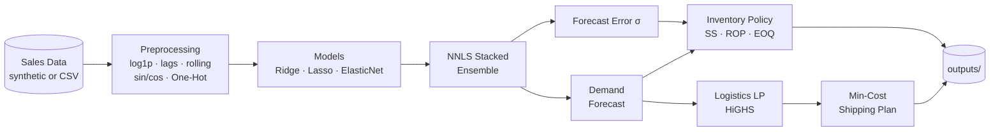

<div align="center">

# 🚚 Smart Supply Chain Optimization

### Demand Forecasting → Inventory Policy → Logistics Optimisation

*From raw sales history to a minimum-cost shipping plan — in one end-to-end pipeline.*


[Overview](#-overview) •
[Features](#-key-features) •
[Architecture](#-architecture) •
[Quick Start](#-quick-start) •
[Methodology](#-methodology) •
[Results](#-sample-results) •
[Roadmap](#-roadmap)

</div>

---

## 📖 Overview

Most supply chain projects stop at *"predict demand."* This one goes further. It connects three decisions that are normally solved in isolation:

| Stage | Question it answers | Tooling |
|:--:|---|---|
| **1. Forecast** | *How much will each SKU sell?* | Ridge / Lasso / ElasticNet + stacked ensemble |
| **2. Inventory** | *How much stock should we hold, and when do we reorder?* | Safety stock, Reorder Point, EOQ |
| **3. Logistics** | *Which warehouse should ship to which region, at what cost?* | Linear programming (HiGHS) |

The key idea: **forecast errors are not thrown away** — they feed directly into safety stock, and the forecasts themselves become the demand inputs of the logistics optimiser.

---

## ✨ Key Features

- 📈 **Leak-free forecasting** — lag/rolling features are shifted, and splits are strictly chronological (no shuffling).
- 🔁 **Rich seasonality handling** — cyclical sin/cos encoding for day-of-week and month.
- 🧠 **Regularised models on 60+ features** — Ridge, Lasso, ElasticNet, tuned with `TimeSeriesSplit` + `GridSearchCV`.
- 🧩 **NNLS stacked ensemble** — blends model predictions using a validation set.
- 📦 **Service-level driven inventory policy** — safety stock, ROP and EOQ from one `--service_level` flag.
- 🚛 **Min-cost shipping plan** — warehouse capacity and regional demand constraints solved with `scipy.optimize.linprog`.
- 📊 **Built-in visualisations** — plots auto-saved to `outputs/`.
- 🔌 **Bring your own data** — plug in any CSV with the expected schema.

---

## 🧰 Key Techniques

| Technique | Purpose |
|---|---|
| `log1p` transform of demand | Stabilise variance on a right-skewed target |
| Lag & rolling features (1 / 7 / 14 / 28 days) | Capture demand momentum (shifted → no leakage) |
| Cyclical encoding (sin / cos) | Day-of-week & month seasonality |
| One-Hot Encoding | SKU, category, region |
| Ridge / Lasso / ElasticNet | Regularised models over 60+ features |
| `TimeSeriesSplit` + GridSearch | Hyper-parameter tuning without look-ahead leakage |
| NNLS stacked ensemble | Optimal non-negative blend of models on validation data |
| Safety stock / ROP / EOQ | Service-level driven inventory policy |
| Linear programming (HiGHS) | Min-cost warehouse → region shipping |

---

## 🏗 Architecture



---

## 📁 Project Structure

```
smart-supply-chain/
├── src/
│   ├── data_generator.py    # Synthetic sales data generator
│   ├── preprocessing.py     # Feature engineering (lags, rolling, cyclical, OHE)
│   ├── models.py            # Ridge / Lasso / ElasticNet + stacked ensemble
│   ├── inventory.py         # Safety stock, reorder point, EOQ
│   ├── logistics.py         # Linear program for warehouse → region shipping
│   ├── visualise.py         # Plots and charts
│   ├── train.py             # End-to-end training pipeline (CLI)
│   └── predict.py           # Inference on new data (CLI)
├── data/                    # Input CSVs (auto-created)
├── models/                  # Saved models (auto-created)
├── outputs/                 # Plots & result tables (auto-created)
├── requirements.txt
└── README.md
```

---

## 🚀 Quick Start

### 1️⃣ Install

```bash
git clone <your-repo-url>
cd smart-supply-chain
pip install -r requirements.txt
```

### 2️⃣ Train on synthetic data (zero setup)

```bash
python -m src.train --tune --save_models
```

### 3️⃣ Train on your own data

```bash
python -m src.train --data data/my_sales.csv
```

### 4️⃣ Predict on new data

```bash
python -m src.predict --model_path models/ensemble.joblib --input_csv data/new.csv
```

### ⚙️ Command-line options

| Flag | Used in | Description |
|---|---|---|
| `--tune` | `train` | Run `TimeSeriesSplit` + GridSearch hyper-parameter tuning |
| `--save_models` | `train` | Persist trained models to `models/` |
| `--data <path>` | `train` | Use your own CSV instead of synthetic data |
| `--service_level <p>` | `train` | Target service level for safety stock (e.g. `0.95`) |
| `--model_path <path>` | `predict` | Path to a saved model |
| `--input_csv <path>` | `predict` | CSV with new rows to forecast |

---

## 🗂 Data Format

Your CSV must contain these columns:

| Column | Type | Description |
|---|---|---|
| `date` | date | Daily timestamp |
| `sku` | string | Product identifier |
| `category` | string | Product category |
| `region` | string | Sales region |
| `unit_price` | float | Price per unit |
| `lead_time_days` | int | Supplier lead time (days) |
| `promo` | 0 / 1 | Promotion flag |
| `holiday` | 0 / 1 | Holiday flag |
| `demand` | int | Units sold *(target)* |

```csv
date,sku,category,region,unit_price,lead_time_days,promo,holiday,demand
2024-01-01,SKU_001,Beverages,North,4.99,5,0,1,132
```

---

## 🔬 Methodology

### 1. Demand Forecasting
- **Chronological** train / validation / test split — no shuffling, so the model never sees the future.
- Target is `log1p(demand)` to tame skew; predictions are inverse-transformed with `expm1`.
- Features: lags and rolling statistics (1/7/14/28 days, shifted), sin/cos calendar encodings, one-hot SKU / category / region, plus price, promo, holiday and lead time.
- Ridge, Lasso and ElasticNet are tuned with `TimeSeriesSplit`, then blended by **NNLS** on the validation set.

### 2. Inventory Policy

Safety stock uses the **forecast error**, not raw demand variability:

```
Safety Stock   SS  = z · σ_error · √L
Reorder Point  ROP = μ · L + SS
EOQ                = √(2 · D · S / H)
```

| Symbol | Meaning |
|---|---|
| `z` | Z-score of the target service level (`--service_level`) |
| `σ_error` | Std. deviation of forecast error |
| `L` | Lead time (days) |
| `μ` | Mean daily demand |
| `D` | Annual demand |
| `S` | Ordering cost per order |
| `H` | Holding cost per unit per year |

### 3. Logistics Optimisation

A linear program decides how many units each warehouse ships to each region:

```
minimise    Σ cost(i,j) · x(i,j)
subject to  Σ_j x(i,j) ≤ capacity(i)     for every warehouse i
            Σ_i x(i,j) ≥ demand(j)       for every region j
            x(i,j) ≥ 0
```

Solved with `scipy.optimize.linprog` (HiGHS backend). Regional demand comes from the hold-out forecasts.

---

## 📊 Sample Results

*Synthetic data, 60-day hold-out.*

| Model | RMSLE ↓ | WAPE % ↓ | R² (log) ↑ |
|---|:---:|:---:|:---:|
| Naive (lag-7) | 0.313 | 23.3 | 0.720 |
| Ridge | 0.208 | 16.1 | 0.876 |
| **Lasso** | **0.205** | **15.6** | **0.880** |
| **ElasticNet** | **0.205** | **15.6** | **0.880** |
| Stacked Ensemble | 0.206 | 15.7 | 0.879 |

**Highlights**

- 🎯 Regularised models cut error by roughly **one third** versus the naive lag-7 baseline (RMSLE 0.313 → ~0.205).
- 🚛 The LP shipping plan reduced transport cost by **~35%** versus a proportional-split baseline.

> **Metrics:** RMSLE = Root Mean Squared Log Error · WAPE = Weighted Absolute Percentage Error · R² (log) is computed on the log-transformed target.

---

## 📝 Notes

- Data is **synthetic**; swap in real sales data (e.g. Kaggle *Store Item Demand* or *M5*) via `--data`.
- Logistics uses hold-out forecasts as the planning horizon; recursive multi-step forecasting is a natural extension.
- Results on real data will differ — re-tune with `--tune`.

---

## 🗺 Roadmap

- [ ] LightGBM / gradient-boosted models
- [ ] Prophet for trend + holiday modelling
- [ ] Vehicle routing with OR-Tools
- [ ] Multi-echelon inventory optimisation
- [ ] Recursive multi-step forecasting for longer horizons
- [ ] Interactive dashboard (Streamlit)

---

## 🤝 Contributing

Contributions are welcome!

1. Fork the repo
2. Create a branch: `git checkout -b feature/your-feature`
3. Commit your changes: `git commit -m "Add your feature"`
4. Push and open a Pull Request

---

## 📄 License

Released under the **MIT License**.

<div align="center">

⭐ *If you found this useful, consider giving the repo a star!* ⭐

</div>
